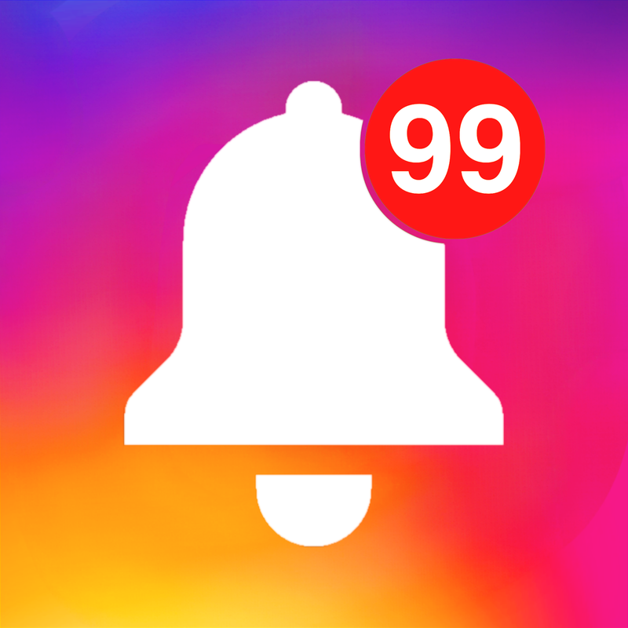
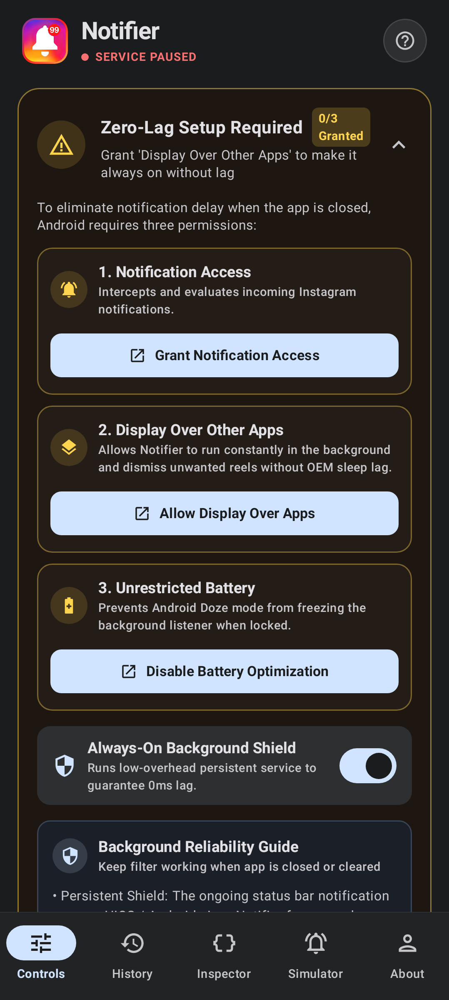
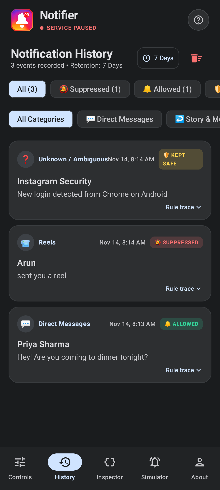
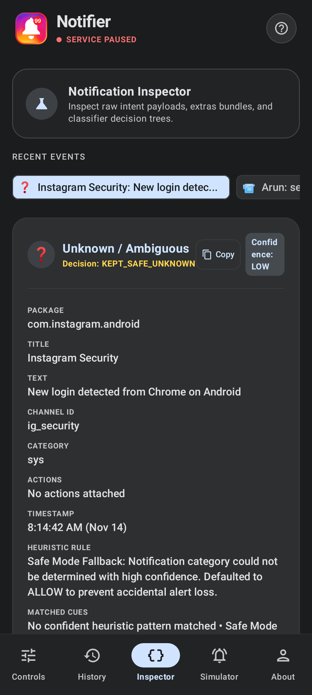
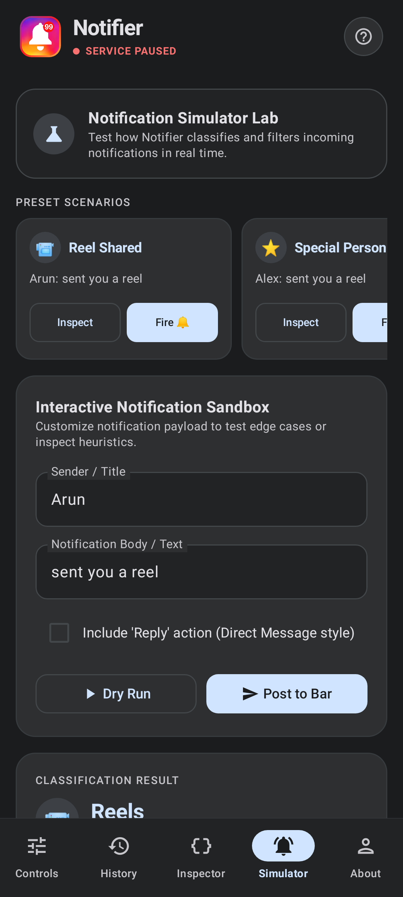
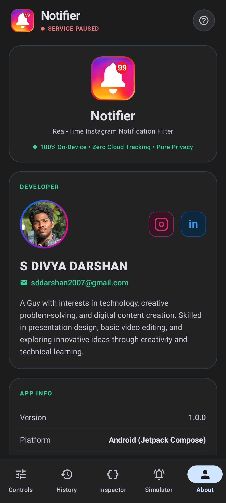

<div align="center">



# Notifier

**An intelligent, 100% on-device Android notification firewall & inspector for Instagram (and custom monitored apps) built with Kotlin, Jetpack Compose, and Room — engineered to silence Reels, Likes, and algorithmic clutter while preserving every important Direct Message with zero-lag dismissal and ~1% battery impact.**

<p>
  <a href="https://drive.google.com/file/d/1ywhPZyPHM975SWrr5G8NZqUy8ENRahEP/view?usp=drive_link">
    
  </a>
  
  
  
  
</p>

### 👉 [**Click Here to Download Notifier APK (Google Drive)**](https://drive.google.com/file/d/1ywhPZyPHM975SWrr5G8NZqUy8ENRahEP/view?usp=drive_link)

</div>

---

## App Screenshots

| Controls & VIP Shield | Interception History | Live Bundle Inspector |
| :---: | :---: | :---: |
|  |  |  |

| Notification Simulator | About & Privacy |
| :---: | :---: |
|  |  |

---

## Overview & Inspiration

**Notifier** began as a solution to a modern digital-wellbeing problem: social apps like Instagram bundle critical **personal Direct Messages** inside the exact same notification stream as **Reels shares, Likes, Follow suggestions, and Live alerts**. Disabling notifications completely risks missing real messages, while leaving them on floods your lock screen.

Instead of blunt OS-level channel muting, Notifier acts as a **real-time local inspection and control layer** built on Android's `NotificationListenerService`. Every incoming notification is extracted, heuristically classified in-memory within microseconds, and either **silently dismissed before it distracts you** or **safely preserved** — all with **zero network calls, zero accounts, and zero data tracking**.

What started as a focused Instagram Reels blocker now includes:
- **12-Category Heuristic Classifier** distinguishing DMs, Reels, Photos & Videos, Shared Posts, Story/Message Reactions, Likes, Comments, Mentions, Follows, Live Broadcasts, Other Activity, and Unknown alerts
- **Critical Safety Principle (Safe Mode Fallback)** ensuring low-confidence or ambiguous security/account alerts are never accidentally dismissed
- **Special Persons (VIP) Whitelist** with a minimalist `+` quick-add header button, **long-press editing**, and granular **"Reels Only" vs. "Allow All Activity"** exceptions
- **Custom Text-Matching Rules Engine** (`STARTS_WITH`, `CONTAINS`, `ENDS_WITH`, `EXACT`) targeting Title, Text, or Both across Instagram or any selected app
- **Always-On OEM Shield** combining a `specialUse` Foreground Service, 20-second `requestRebind` watchdog, `BOOT_COMPLETED` auto-recovery, and an optional `1x1` transparent overlay for aggressive OEM task killers (HiOS, MIUI, ColorOS)
- **Live Inspector & Notification Simulator** to inspect raw Android `Bundle` extras, `MessagingStyle` payloads, and dry-run or dispatch test notifications on demand

---

## Core Classification & Filtering Pipeline

Notifier's filtering engine runs synchronously in `InstagramNotificationListenerService` using pre-warmed `@Volatile` in-memory caches backed by Room flows — eliminating database read latency on the hot notification path:

### 1. Metadata & `MessagingStyle` Extraction (`NotificationInspectorManager`)
- Parses `EXTRA_TITLE`, `EXTRA_TITLE_BIG`, `EXTRA_CONVERSATION_TITLE`, `EXTRA_TEXT`, `EXTRA_BIG_TEXT`, `EXTRA_SUB_TEXT`, `EXTRA_TEXT_LINES`, and Android's `MessagingStyle` `android.messages` arrays.
- Separates **current event text** (`title + text + subText`) from historical `bigText` conversation lines so a previous Reel link in a chat thread never causes a brand-new `"Hi"` message to be misclassified as a Reel.

### 2. Multi-Stage Decision Engine (`InstagramNotificationClassifier`)
Notifications are evaluated in strict priority order:
1. **Custom User Filter Rules (Highest Priority):** Evaluates enabled user-defined `CustomFilterRuleEntity` rules (`STARTS_WITH`, `CONTAINS`, `ENDS_WITH`, `EXACT`) scoped to `TITLE`, `TEXT`, or `BOTH` for a specific package or wildcard (`*`).
2. **Special Persons (VIP) Exceptions:** Matches incoming handles (`@username`) or custom nicknames against the Room VIP list. Supports letting a VIP bypass **only Reels** (`reelsOnly = true`) or allowing **all activity** (`reelsOnly = false`).
3. **12-Category Heuristic Classification:** Inspects phrasing cues, notification channel IDs, Android `CATEGORY_MESSAGE` metadata, `RemoteInput` reply actions, and `MessagingStyle` extras.
4. **Safety Principle Fallback (`Safe Mode`):** If classification confidence is `LOW` or the format is `UNKNOWN` (such as Instagram security/login alerts), Notifier strictly refuses to dismiss (`KEPT_SAFE_UNKNOWN` / `KEPT_SAFE_LOW_CONFIDENCE`), guaranteeing critical alerts are never lost.

### 3. Zero-Lag Dismissal & Orphaned Summary Cleanup
- Suppressed notifications are canceled immediately via `cancelNotification(sbn.key)` + `snoozeNotification(sbn.key, 86400000L)` (API 26+) + tag/ID fallback **before** asynchronous Room logging runs.
- Includes a lightweight **1.6-second OEM retry loop** (`2` attempts at `800ms` intervals) and automatically cleans up orphaned `FLAG_GROUP_SUMMARY` group headers when all child notifications have been dismissed.

---

## Instagram Notification Categories

Configure each category independently as **Allow** or **Suppress** from the **Controls** tab:

| Category | Default Action | What It Captures |
| :--- | :---: | :--- |
| **Direct Messages** (`DIRECT_MESSAGES`) | `ALLOW` | 1-on-1 & group chats (detected via `RemoteInput` reply actions, `CATEGORY_MESSAGE`, and `MessagingStyle`) |
| **Story & Message Reactions** (`STORY_REPLIES`) | `ALLOW` | Story replies and DM emoji reactions (*"Reacted 😂 to your message"*) |
| **Mentions & Tags** (`MENTIONS`) | `ALLOW` | Comments, captions, or stories where you are `@mentioned` or tagged |
| **Reels** (`REELS`) | `SUPPRESS` | Shared Reels, clips, and video recommendations *(with VIP Special Persons bypass)* |
| **Photos & Videos** (`PHOTOS_AND_VIDEOS`) | `SUPPRESS` | Feed photo posts, carousel albums, and video uploads |
| **Shared Posts** (`SHARED_POSTS`) | `SUPPRESS` | Direct-chat feed post shares and media attachments |
| **Likes & Reactions** (`LIKES`) | `SUPPRESS` | Likes on your posts, reels, stories, or comments |
| **Comments** (`COMMENTS`) | `SUPPRESS` | New comments and comment replies on your posts |
| **Follows & Requests** (`FOLLOWS`) | `SUPPRESS` | New followers, follow requests, and accepted requests |
| **Live Broadcasts** (`LIVE`) | `SUPPRESS` | Alerts when followed accounts start a live video stream |
| **Other Activity** (`OTHER`) | `SUPPRESS` | Broadcast channels, anniversary memories, and platform tips |
| **Unknown / Ambiguous** (`UNKNOWN`) | `ALLOW` | Unrecognized structures — **always preserved under the Safety Principle** |

---

## Battery Optimization & Always-On Architecture

Notifier is engineered to stay active 24/7 with **~1% daily battery impact** (`0–3%` max overhead):

- **100% Event-Driven (Zero Polling):** `InstagramNotificationListenerService` remains completely dormant at `0%` CPU until the Android OS delivers an incoming `StatusBarNotification`.
- **Micro-Wakelocks (`2.5s` Cap):** Acquires a non-reference-counted `PARTIAL_WAKE_LOCK` (`Notifier:ListenerLock`) capped at **`2,500ms`**, releasing immediately once synchronous classification completes and asynchronous logging is handed off.
- **Zero Network Radio Wakeups:** All rule matching, VIP detection, and Room persistence run strictly on-device without touching Wi-Fi or Cellular radios.
- **Halved OEM Fallback Retries:** The post-dismissal safety check runs only 2 lightweight checks over `1.6s` instead of continuous CPU polling.
- **OEM Task-Killer Resilience (`AlwaysOnProtectionService`):**
  - Uses `FOREGROUND_SERVICE_TYPE_SPECIAL_USE` (`IMPORTANCE_LOW`, silent channel) and a 20-second `requestRebind()` connectivity check to recover if an aggressive OEM power manager unbinds the listener.
  - Automatically restores protection on device reboot or app update via `BootCompletedReceiver` (`BOOT_COMPLETED` & `MY_PACKAGE_REPLACED`).
  - Optional `1x1` invisible overlay (`InvisibleOverlayManager` via `SYSTEM_ALERT_WINDOW`) to prevent aggressive OEM ROMs (such as HiOS or MIUI) from killing background protection.

---

## App Screens & Features

- **Controls (`ControlsScreen`):**
  - Live **Shield Status** banner (`SHIELD ACTIVE` / `SERVICE PAUSED`), blocked-vs-allowed telemetry summary, and one-tap **Notification Access** & **Battery Optimization** setup helpers.
  - **Quick Presets** (`Only DMs`, `Only Reels`, `Only Photos & Videos`, `Special Persons Reels`, `Personal Only`, `Balanced`, `Allow All`, `Focus Shield`), per-category **Allow / Suppress** toggles, and **Safe Mode** toggle.
  - **Special Persons (VIPs):** Minimalist `+` button in the section header to add `@username` + nickname, plus **long-press to edit** any VIP entry or toggle Reels access.
  - **Custom Filter Rules & Monitored Apps:** Add keyword/exact-match rules and extend filtering beyond `com.instagram.android` / `com.instagram.lite` to any installed app.
  - **History Retention Policy:** Configurable automatic log pruning (`24 Hours`, `3 Days`, `7 Days`, `30 Days`, or `Forever`).
- **History (`HistoryScreen`):** Filterable log of every intercepted notification with category chips, decision badges (`SUPPRESSED`, `ALLOWED`, `KEPT_SAFE_*`), exact rule explanations, and timestamps.
- **Inspector (`InspectorScreen`):** Developer-grade real-time `StatusBarNotification` inspector showing raw Android `Bundle` extras, `channelId`, `actions`, `matchedCues`, and classification confidence.
- **Simulator (`SimulatorScreen`):** 12 built-in preset scenarios (Reel Shared, Special Person Reel, DM, Story Reply, Ambiguous Security Alert, etc.) supporting both **instant dry-run classification** and **real OS notification dispatch** via `TestNotificationSender`.
- **About (`AboutUsScreen`):** App mission, privacy guarantees, and creator profile.

---

## Tech Stack & Architecture

- **Language:** Kotlin
- **UI Framework:** Jetpack Compose + Material Design 3 (Edge-to-Edge Dark Theme, `NavigationBar`, `Scaffold`)
- **Architecture:** MVVM (`NotifierViewModel` + `StateFlow` / `collectAsStateWithLifecycle`) with unidirectional data flow
- **Local Persistence:** Room Database (`AppDatabase`, `NotificationDao`, `NotificationRepository`, schema `v3`) with 5 entities:
  - `NotificationLogEntity`
  - `CategoryPreferenceEntity`
  - `SpecialPersonEntity`
  - `CustomFilterRuleEntity`
  - `MonitoredAppEntity`
- **Background Services & Receivers:** `NotificationListenerService`, `AlwaysOnProtectionService` (`specialUse` FGS), `BootCompletedReceiver`, `InvisibleOverlayManager`
- **Concurrency:** Kotlin Coroutines & Flow (`Dispatchers.IO` background logging, `@Volatile` in-memory classifier cache)
- **Branding:** Custom adaptive launcher icon (`ic_launcher`) & bespoke shield notification icon (`ic_notification_shield`)
- **Testing:** JUnit4, Robolectric (`ExampleRobolectricTest`), and Roborazzi screenshot tests (`NotifierScreenshotsTest`, `GreetingScreenshotTest`)

---

## Project Structure

```text
├── docs/
│   └── screenshots/                           # Roborazzi UI screenshots rendered for README
└── app/src/
    ├── main/
    │   ├── AndroidManifest.xml                # Listener, Always-On FGS, BootReceiver & permissions
    │   ├── res/drawable/app_logo.png          # Custom Notifier logo asset
    │   └── java/com/example/
    │       ├── MainActivity.kt                # Edge-to-edge host, permission prompts & service bootstrap
    │       ├── classifier/
    │       │   └── InstagramNotificationClassifier.kt # Custom rules, VIP exceptions, 12-category & Safe Mode engine
    │       ├── data/
    │       │   ├── AppDatabase.kt             # Room database (v3)
    │       │   ├── NotificationDao.kt         # Reactive Flow queries, stats & retention pruning
    │       │   ├── NotificationRepository.kt  # Fast sync cache + Room repository abstraction
    │       │   ├── CategoryPreferenceEntity.kt
    │       │   ├── SpecialPersonEntity.kt
    │       │   ├── CustomFilterRuleEntity.kt
    │       │   ├── MonitoredAppEntity.kt
    │       │   └── NotificationLogEntity.kt
    │       ├── model/
    │       │   ├── InstagramCategory.kt       # 12 categories, FilterAction, ConfidenceLevel & FilterDecision
    │       │   └── HistoryRetention.kt        # Log auto-cleanup intervals (24h to Forever)
    │       ├── service/
    │       │   ├── InstagramNotificationListenerService.kt # Real-time listener, 2.5s wakelock & zero-lag cancel
    │       │   ├── AlwaysOnProtectionService.kt # specialUse Foreground Service + 20s rebind watchdog
    │       │   ├── BootCompletedReceiver.kt   # Auto-restore shield on boot & app update
    │       │   ├── InvisibleOverlayManager.kt # Optional 1x1 overlay for aggressive OEM battery savers
    │       │   ├── NotificationInspectorManager.kt # Bundle extras & MessagingStyle metadata extractor
    │       │   └── TestNotificationSender.kt  # 12 preset simulation notifications & RemoteInput test sender
    │       ├── viewmodel/
    │       │   └── NotifierViewModel.kt       # App state, filters, VIP CRUD, rules & simulator actions
    │       └── ui/
    │           ├── NotifierApp.kt             # Top shield bar, 5-tab NavigationBar & Help dialog
    │           ├── components/                # CustomRulesComponents, MonitoredAppsComponents, PermissionBanner
    │           ├── screens/                   # Controls, History, Inspector, Simulator & AboutUs screens
    │           └── theme/                     # Material 3 Dark Theme, ColorScheme & Typography
    └── test/java/com/example/
        ├── ExampleUnitTest.kt                 # JVM unit tests
        ├── ExampleRobolectricTest.kt          # Robolectric context & resource verification
        ├── GreetingScreenshotTest.kt          # Roborazzi greeting snapshot test
        └── NotifierScreenshotsTest.kt         # Captures all 5 app screens into docs/screenshots/
```

---

## Download & Install APK

> **Ready to try Notifier on your Android device (`Android 7.0+`)?**

1. [**Download the Notifier APK from Google Drive**](https://drive.google.com/file/d/1ywhPZyPHM975SWrr5G8NZqUy8ENRahEP/view?usp=drive_link).
2. Tap the downloaded `.apk` file and allow **Install unknown apps** if prompted by Android.
3. Open **Notifier**, tap the permission banner on **Controls**, and enable **Notification Access** for *Instagram Notification Controller*.
4. *(Recommended)* Exempt Notifier from battery optimization in device settings so your shield stays active 24/7.

---

## Building from Source & Running Tests

### 1. Build the Debug APK
```bash
gradle assembleDebug
```

### 2. Run Unit & Robolectric Tests
```bash
gradle :app:testDebugUnitTest
```

### 3. Re-generate README Screenshots via Roborazzi
```bash
gradle :app:recordRoborazziDebug --tests 'com.example.NotifierScreenshotsTest'
```

---

## How to Use

1. **Activate the Shield:** Open **Controls**, tap the permission banner to enable **Notification Access**, and verify the top status badge switches to **SHIELD ACTIVE**.
2. **Tune Your Categories:** Keep **Direct Messages**, **Story & Message Reactions**, and **Mentions** set to **Allow**, while keeping **Reels**, **Likes**, and **Follows** set to **Suppress**.
3. **Add Special Persons (VIPs):** Tap the **`+`** icon next to **Special Persons** to whitelist close friends by `@username` and nickname — **long-press** any saved person anytime to edit their handle, nickname, or **Reels Allowed** toggle.
4. **Verify Safely with Simulator & Inspector:** Open the **Simulator** tab to dry-run or fire real test notifications, then inspect the exact classification decision and raw `Bundle` metadata in **Inspector** and **History**.

---

## Author

Created by **S DIVYA DARSHAN** — `sddarshan2007@gmail.com`
